[中文版](./cla使用指南.md)

# CLA Usage Guide

<a id="cla-signing-flowchart"></a>
## 👉 CLA Signing Flowchart

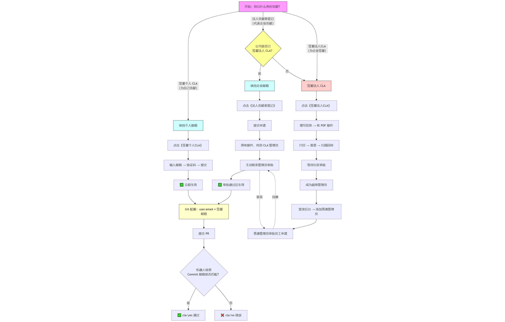

<a id="hpckit-homepage"></a>
## [👉 HPCKit Community CLA Signing Homepage](https://clasign.osinfra.cn/sign/68cbd4a3dbabc050b436cdd4)


---
Based on your identity, select the corresponding operation process. This is the fastest way to complete the signing.

<a id="personal-contributor"></a>
## 🤔 I am an individual developer, contributing for myself

### [👉 Sign Individual CLA](https://clasign.osinfra.cn/sign-cla/68cbd4a3dbabc050b436cdd4/individual)


**This is the fastest path, with no waiting required, and it takes effect immediately.**

### Operation Steps:

1.  **Select "Sign Individual CLA"**
2.  **Enter your email**
    - ✅ **Personal email is recommended** (e.g., Gmail, Outlook, QQ mail, etc.)
    - ⚠️ **Important notes on corporate email**:
        - If your company **has not yet** signed the Corporate CLA, you can use your corporate email for individual signing.
        - However, if your company **subsequently signs** the Corporate CLA, the Individual CLA you previously signed with your corporate email **will automatically become invalid**.
        - To avoid future troubles, it is strongly recommended to use a personal email directly.

3.  **Check the email verification code**, then return to the page to fill it in and submit.
4.  **Done!** The system will immediately prompt you that the signing is successful.

### Email Selection Recommendations:

| Email Type | Recommendation Level | Description |
|---------|----------|------|
| Personal Email | ⭐⭐⭐⭐⭐ | Safest, no risk of future conflicts. |
| Corporate Email (Company has not signed CLA) | ⭐⭐ | Temporarily usable, but has a risk of future invalidation. |
| Corporate Email (Company has signed CLA) | ❌ Unusable | Must go through the corporate employee process. |

**Best Practice**: Regardless of whether your company has currently signed the CLA, it is recommended to use a personal email to sign as an Individual Contributor once and for all.

### Important Notes:

If you use a corporate email, and the company corresponding to that email domain has already signed the Corporate CLA, the system will automatically recognize it and recommend you to proceed with the "Corporate Employee" process below. You will not be able to complete the individual signing.

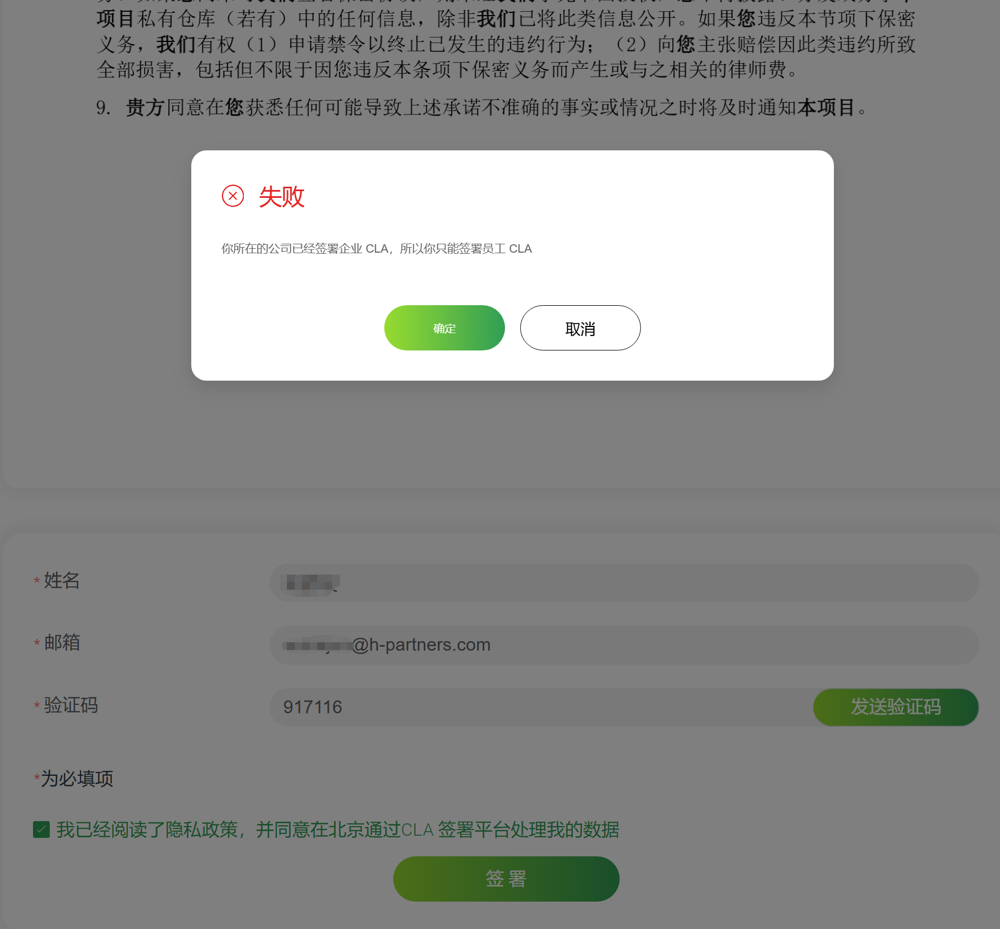

---

<a id="employee-contributor"></a>
## 🏢 I am a corporate employee, contributing on behalf of the company

### [👉 Corporate Contributor Registration](https://clasign.osinfra.cn/sign-cla/68cbd4a3dbabc050b436cdd4/employee)


**Note: If you are a school teacher or student, please select the corresponding process based on your contribution identity:**
- Contributing on behalf of the school: Please refer to this corporate employee process and use your school email to sign.
- Independent individual contribution: Please select the "I am an individual developer, contributing for myself" process and use a personal email to sign.

**This process requires approval from the company administrator, please follow up patiently.**

### Operation Steps:

1.  **Submit application using corporate email**
    - Be sure to use your corporate email (e.g., `your-name@your-company.com`) to sign.
    - The system will automatically identify your corporate identity.

2.  **Check email and contact administrator (Critical step!)**
    - After submitting the application, be sure to **check the confirmation email sent by the system**.
    - This email will explicitly tell you: **who your company's CLA administrator is** (usually your department head or R&D interface person).
    - At this time, your application status is **"Pending Approval"**.

3.  **Wait for administrator approval**
    - **Please proactively contact your CLA administrator immediately based on the information provided in the email.**
    - Ask them to log into the system and **approve your application** in the management backend.
    - **Only after their approval will your signing officially take effect.**

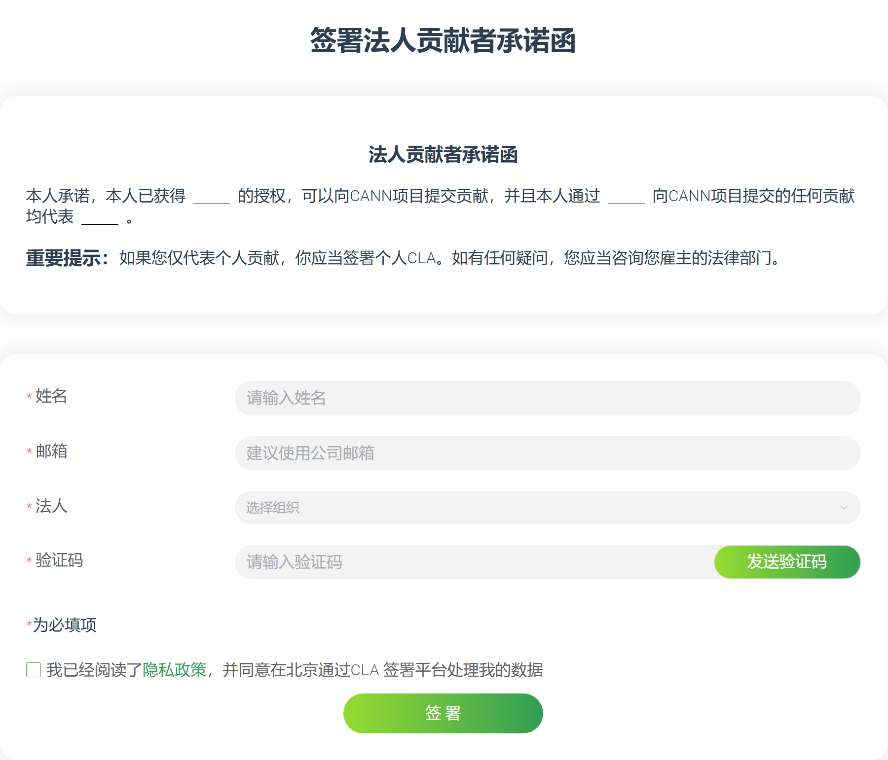

---

<a id="company-representative"></a>
## 🏛️ I am a corporate representative, needing to sign the CLA for the company

### [👉 Sign Corporate CLA](https://clasign.osinfra.cn/sign-cla/68cbd4a3dbabc050b436cdd4/corporation)

 

**Note: School representatives please refer to this process to sign the CLA for the school.**

**This process is the most complex and needs to be completed by you on behalf of the company.**

### Operation Steps:

1.  **Prepare materials and submit for review**
    - The corporate signer clicks the Sign Corporate CLA button on the signing page to enter the signing page and fill out the signing form (the signing email cannot be changed, please use a relatively stable email to sign the Corporate CLA).
    - The corporate email will receive an email with a PDF attachment. The PDF contains the previously signed CLA content. Please print the PDF file and affix the official company seal.
    - Scan the CLA agreement file with the official seal, signature, and date as a PDF file, and reply to the previously received email with it as an attachment to complete the Corporate CLA signing.

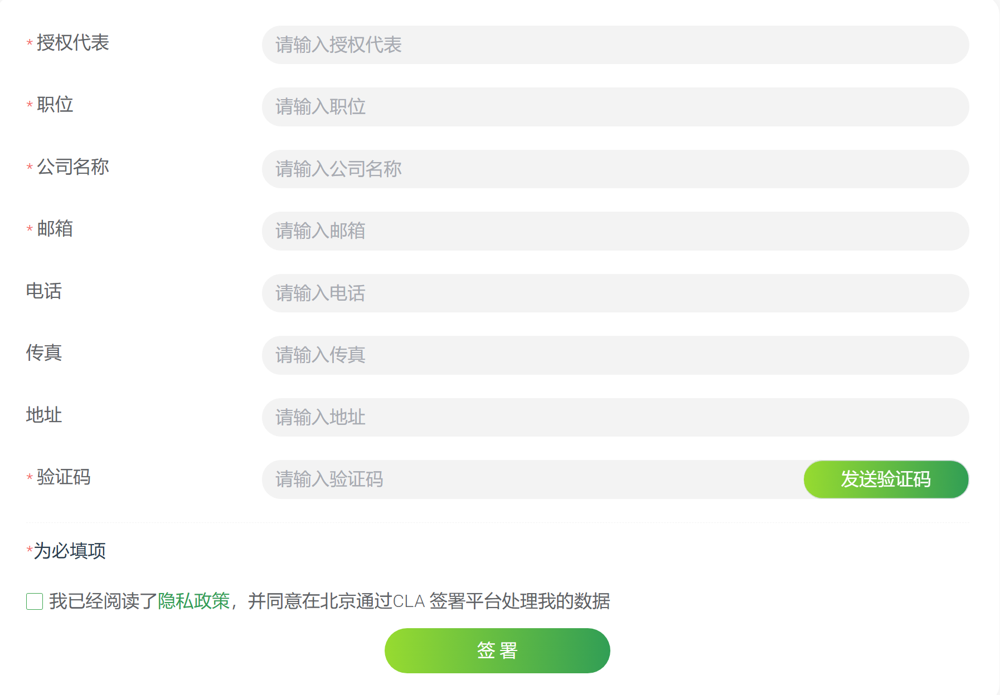

2.  **Become a super administrator**
    - After receiving the email, the **community administrator** of the HPCKit community will check and verify the PDF.
    - After the check is passed, the email used to sign the Corporate CLA will receive an email confirming the successful signing, which contains the username and initial password of the **super administrator** account.

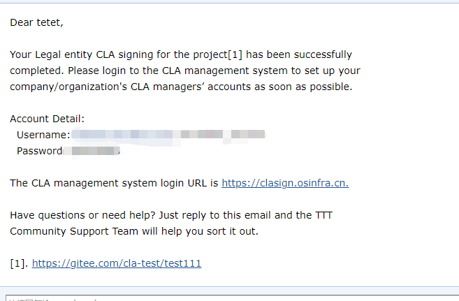

3.  **Set up the company's approval personnel (Crucial! The super administrator and ordinary administrator cannot be the same account)**
    - The super administrator clicks the Corporate Administrator button on the signing page to enter the super administrator login page, and logs in using the username and initial password of the **super administrator** account obtained previously (remember to update the password).
    - As a super administrator, your primary task is: **immediately create several "ordinary administrators" for the company** (e.g., heads of various R&D teams), and assign the daily work of **approving employee applications** to them to ensure a smooth internal CLA process for the company.
    - The ordinary administrator will also receive an email containing the username and initial password of the **ordinary administrator** account. Their login process is consistent with that of the super administrator.
    - After that, you can have your employees register as corporate contributors, and then have the ordinary administrators approve them.

4. **Click Corporate Administrator and log in using the super administrator or ordinary administrator account.**

---
<a id="company-manager"></a>
## 👥 I am a corporate administrator, responsible for approving employee contribution permissions

### [👉 Corporate Administrator](https://clasign.osinfra.cn/corporation-manager-login/68cbd4a3dbabc050b436cdd4)


- **Page after super administrator login**

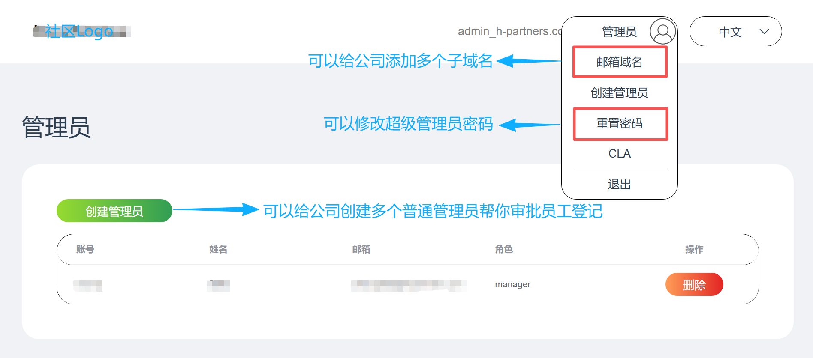

- **Page after clicking the email domain**

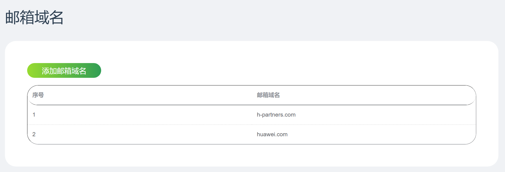

- **Page after clicking reset password**

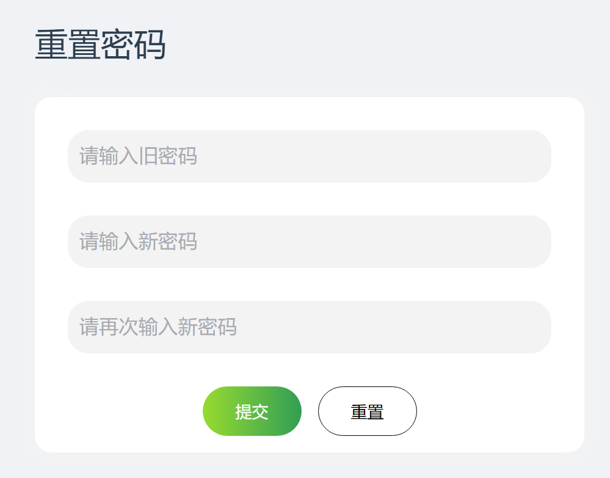

- **Page after ordinary administrator login**

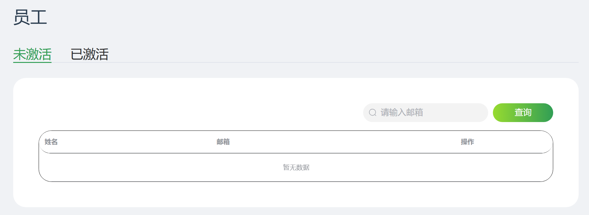

### Administrator Responsibilities:

- **Super Administrator**: Responsible for managing ordinary administrators, does not directly approve employees.
- **Ordinary Administrator**: Responsible for the daily approval of CLA signing applications from company employees.
---

<a id="cla-signing-status-verification"></a>
## ✅ CLA Signing Status Verification (Individuals and Corporate Employees)

After signing is complete, you can verify it through the following link (replace the email with your actual information when signing the CLA):

https://clasign.osinfra.cn/api/v1/individual-signing/69ca19493107795d582d07fc?email=your-email@example.com


**Success Indicator**: The return result must contain two `true` values.

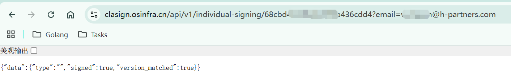

If the return result does not meet the above requirements, it indicates that the signing failed.

---

<a id="important-notes"></a>
## ⚠️ Important Notes

Even if the CLA is signed successfully, it **does not mean** you can immediately contribute code to the community. When submitting a PR, the community bot will check the contributor's CLA status.

### Check Mechanism

- The bot verifies the CLA status through the **Commit email when submitting code**.
- If the email configured in Git is inconsistent with the email used when signing the CLA, the check will fail.
- Example error message: `cann-cla/no`

<a id="git-email-configuration"></a>
## 🔧 Git Email Configuration

### Basic Principle

**Whatever email you use when signing the CLA, you must use the same email when submitting code.**

### Pre-submission Check and Configuration

Before submitting code, it is recommended to first check and correctly configure the Git email:

#### Check current Git configuration

Git configuration has three levels (from highest to lowest priority):
- **Local configuration** (`--local`): Valid only for the current repository.
- **Global configuration** (`--global`): Valid for all repositories of the current user.
- **System configuration** (`--system`): Valid for all users.

It is recommended to check the configuration in the following order:

```bash
# 检查当前仓库的本地配置（优先级最高）
git config user.name
git config user.email

# 检查全局配置
git config --global user.name
git config --global user.email

# 检查系统配置
git config --system user.name
git config --system user.email
```

#### Check Result Description:

  - If the command has output, it displays the currently configured username and email.

  - If the command has no output, it means the corresponding configuration is not set at that level.

  - Git will use the first configuration found based on priority.

#### Configure Git Email Information

Choose the appropriate configuration level according to your needs:

```bash
# 配置当前仓库的本地信息（推荐用于公司项目）
git config user.name "你的姓名"
git config user.email "签署CLA的邮箱"

# 配置全局信息（推荐用于个人项目）
git config --global user.name "你的姓名"
git config --global user.email "签署CLA的邮箱"
```

#### Configuration Recommendations

  - If you mainly contribute to personal projects, use the `--global` configuration.

  - If you contribute to corporate projects, it is recommended to use the `--local` configuration in the project directory.

  - Use `git config --list --show-origin` to verify if the configuration takes effect.

<a id="faq"></a>
## ❓ FAQ

#### 1. **Guidelines for handling the red hpckit-cla/no label after submitting a PR**

##### Problem Description
The appearance of the `hpckit-cla/no` label indicates that the authors of some commits in the PR have not signed the HPCKit community's Contributor License Agreement (CLA).

##### Handling Process

Step 1: Confirm CLA signing status

Visit the CLA signing address provided in the PR comments area to confirm the signing status:

- **Individual Contributor**: Select "Sign Individual CLA".
- **Corporate Contributor**:
  - Employees whose company has already signed the Corporate CLA: Select "Corporate Contributor Registration".

Step 2: Handle based on signing status

##### Situation A: CLA not yet signed
1. Complete the CLA signing.
2. Comment `/check-cla` in the PR comments area.
3. The system will automatically update the label to `hpckit-cla/yes`.

> Note: Corporate CLA requires administrator approval.

##### Situation B: CLA already signed

**1. Check commit email**
```bash
git log --pretty=fuller
```
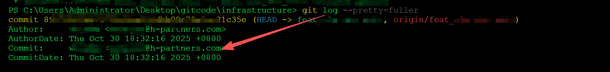

**2. Handle based on check results**

Sub-situation B1: Commit email is inconsistent with CLA email

| Scenario | Solution Option | Operation Steps |
|------|----------|----------|
| Commit email is consistent with Gitcode submission email | Re-sign using this email | Re-sign CLA using the commit email |
| Want to sign using the commit email | Adjust Gitcode settings | Add the commit email in Gitcode settings and set it as the submission email |
| Want to sign using the Gitcode submission email | Adjust local git configuration | Use `git config --local user.email "email"` to modify the configuration |

**Commands to correct commit email:**

```bash
# 修正最后一次提交
git -c user.name="正确姓名" -c user.email="正确邮箱" commit --amend --reset-author

git commit --amend --author="正确姓名 <正确邮箱>" --no-edit

# 强制推送
git push --force

# 修正多个提交
# 1. 交互式rebase
git rebase -i <commit_id>~n

# 2. 将pick改为edit，逐一执行：
git commit --amend --author="正确姓名 <正确邮箱>" --no-edit
git rebase --continue

# 3. 强制推送
git push --force
```

Sub-situation B2: Commit email is consistent with CLA email

- Submit an issue in the current repository.

- Provide the PR link and CLA email information.

- Wait for community maintainers to handle it.

**Precautions**

- The CLA check is based on the committer email in the commit history.

- Modifying the commit history requires force push permissions.

- If you have any questions, please leave a message in the PR comments area or submit an issue.

#### 2. When registering a corporate email, it prompts "There is no information for this company"

| Please refer to the "🏢 I am a corporate employee, contributing on behalf of the company" section in the [CLA Usage Guide](../cla/cla使用指南.md) in this document.

| Error Scenario | Optimized Error Prompt | Description and Guidance |
|---------|------------------|-----------|
| **Company unregistered** | **❌ Company has not signed the agreement**<br>Your company (domain: `@your-company.com`) has not yet completed the Corporate CLA signing in the system. | **1. Contact Company:** Please inform your department head or legal team of this matter and ask them to complete the company signing as a **corporate representative**.<br>**2. Temporary Solution:** If you want to contribute immediately, you can first use a **personal email** to sign as an **Individual Contributor**. |
| **Company registered, but user email domain does not match** | **❌ Email domain does not match the signed company**<br>The email you are using (`@other-company.com`) does not match the domain of the company that signed the CLA (`@your-company.com`). | **Solution:** Please switch to your company's corporate email account to operate, or log in using the account corresponding to that email. |

#### 3. Can the same domain/email be signed multiple times?

| Please refer to the "🏛️ I am a corporate representative, needing to sign the CLA for the company" section in the [CLA Usage Guide](../cla/cla使用指南.md) in this document.

| Error Scenario | Optimized Error Prompt | Description and Guidance |
|---------|------------------|-----------|
| **Repeatedly signing Corporate CLA** | **❌ Corporate agreement already exists**<br>Your company (domain: `@your-company.com`) has completed the Corporate CLA signing and does not need to repeat the operation. | **Next Step:** If you are a new employee of the company, please proceed with [**Corporate Contributor Registration**]. If you are an administrator, please [**Log in to the Management Backend**] directly. |

#### 4. Corporate employee registers using a personal email

| Please refer to the "🤔 I am an individual developer, contributing for myself OR 🏢 I am a corporate employee, contributing on behalf of the company" section in the [CLA Usage Guide](../cla/cla使用指南.md) in this document.

| Error Scenario | Optimized Error Prompt | Description and Guidance |
|---------|------------------|-----------|
| **Corporate employee uses personal email and selects "Corporate Signing"** | **❌ Incorrect identity path selection**<br>It is detected that you are using a personal email, but have selected the corporate signing path. | **Please select:**<br>• **Option A (Recommended):** Switch to your **corporate email** to complete the corporate employee registration.<br>• **Option B:** Continue using the current email, but your identity will switch to **Individual Contributor**, and your contributions will not represent the company. |
| **Corporate employee uses personal email and selects "Corporate Contributor Registration"** | **❌ Invalid email type**<br>Corporate employee registration must use a corporate email. The one you are currently using (`@gmail.com`) is a personal email. | **Solution:** Please switch to your corporate email account to operate. If you do not have a corporate email, please contact your company's IT department or CLA administrator. |

#### 5. Q: What should I do if I cannot receive the CLA signing email from the community or cannot find the administrator?
**A: First, check your email's spam folder. If you still cannot find it, please ask in your company's technical communication group or directly ask your supervisor: "Who is the approval person in charge of our company's open-source CLA?"**

<a id="remark"></a>
## 💡 Remarks

During use, if you encounter any problems or need assistance, you are welcome to contact us through the following methods:

### Issue Feedback Channels

| Method | Description | Response Time |
|------|------|----------|
| 📝 **Submit ISSUE** | Report issues through the Issue section of the project repository | 1-5 working days |
| 👥 **Contact Infrastructure SIG** | Directly contact the Infrastructure Special Interest Group for professional technical support | Timely response |
| 💬 **Community Discussion** | Participate in relevant technical community discussions to exchange experiences with other developers | Real-time communication |

We are dedicated to providing you with help to ensure a smooth and worry-free usage process.