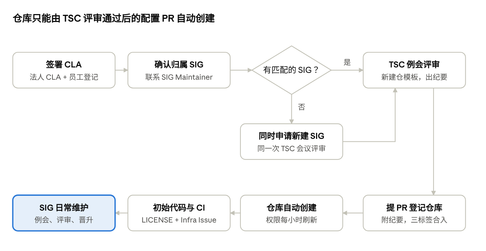

# HPCKit 社区新仓库创建指南

## 概述

向 HPCKit 社区贡献一个新仓库，需要经过「签署 CLA、确定 SIG、TSC 评审、提 PR 建仓、接入 CI」五个环节，之后以 Committer 身份长期维护。本指南适用于企业、高校、科研院所等组织及个人开发者；如只向现有仓库贡献代码，阅读第一节和第五节即可。



TSC 为月度例会，评审纪要是后续建仓 PR 的必要凭证；没有匹配的 SIG 时，新建 SIG 与建仓可在同一次会议评审。法人 CLA 需要盖章和核对，建议与准备申报材料同时启动。

## 一、前置准备：账号与 CLA

每一位提交者都必须先签署 HPCKit CLA，否则 PR 会被打上 `hpckit-cla/no` 标签，无法合入任何仓库，包括建仓用的 hpckit-community 仓库。

### 1.1 账号准备

- 每位参与人注册 AtomGit（GitCode）账号，并在个人设置中添加计划用于提交代码的邮箱，设为提交邮箱。
- 本地 git 配置的 `user.email` 必须与签署 CLA 的邮箱完全一致，建议在仓库内执行 `git config --local user.email "<签署邮箱>"`。
- 订阅 [TSC 邮件列表](https://mailweb.hpckit.osinfra.cn/mailman3/lists/tsc.lists.hpckit.osinfra.cn)，建仓议题、评审纪要都通过这里发布。
- 登录 [社区会议平台](https://meeting.hpckit.osinfra.cn) 个人中心，把 AtomGit 账号与平台账号绑定；成为 Maintainer/Committer 后才会自动获得建会权限。

### 1.2 选择签署类型

签署入口：[HPCKit 社区 CLA 签署首页](https://clasign.osinfra.cn/sign/69ca19493107795d582d07fc)。以企业身份贡献时，应签署「法人 CLA + 员工登记」，而不是由员工各自签署个人 CLA。

| 身份 | 签署类型 | 使用邮箱 | 何时生效 |
| --- | --- | --- | --- |
| 企业（法务或授权代表） | 法人 CLA | 企业域名邮箱，长期稳定的公共邮箱 | 盖章 PDF 回传并经社区管理员核对后 |
| 企业员工 | 法人贡献者登记 | 本人企业邮箱，域名须与法人 CLA 一致 | 企业 CLA 管理员审批后 |
| 以个人名义贡献的开发者 | 个人 CLA | 个人邮箱 | 提交后立即生效 |
| 高校、科研院所 | 按法人 CLA 流程 | 学校或机构邮箱 | 同法人 CLA |

### 1.3 法人 CLA 签署步骤

1. 企业代表在签署页选择「签署法人 CLA」，填写表单。签署邮箱签后不能修改。
2. 签署邮箱会收到带 PDF 附件的邮件：打印、加盖企业公章、签字并写日期，扫描成 PDF 后直接回复该邮件。
3. HPCKit 社区管理员核对 PDF，通过后签署邮箱收到**超级管理员**账号和初始密码。
4. 超级管理员登录企业管理员后台，修改密码，并创建若干**普通管理员**（如各研发团队负责人），由普通管理员负责日常审批员工登记。超级管理员和普通管理员不能是同一个账号。
5. 员工用企业邮箱做「法人贡献者登记」，再主动联系本企业 CLA 管理员审批，审批通过后签署才生效。

### 1.4 签署结果自查

把邮箱替换为自己的签署邮箱后访问以下地址，返回已签署即可：

`https://clasign.osinfra.cn/api/v1/individual-signing/69ca19493107795d582d07fc?email=<your-email>`

签署成功不等于提交一定通过：PR 中每个 commit 的作者邮箱都会被机器人逐一检查，任何一个未签署都会触发 `hpckit-cla/no`。完整说明见 hpckit-community 仓库 `docs/cla/cla使用指南.md`。

## 二、License 与版权合规

每个仓库根目录必须有 `LICENSE` 文件，新建源码文件必须带版权声明头。社区推荐使用木兰宽松许可证第 2 版（Mulan PSL v2）。

### 2.1 许可证选择

| 场景 | 做法 |
| --- | --- |
| 自研的新项目 | 优先 Mulan PSL v2，与社区模板一致；如需 Apache-2.0 等其他宽松许可证，在建仓申报材料里写明理由，由 TSC 评审确认 |
| Fork 自上游的开源项目（如 lammps、sglang 这类） | 必须沿用上游许可证，不得更换；保留上游 `LICENSE`、`NOTICE` 和原有版权声明 |
| 从企业内部闭源代码转为开源 | 先完成企业内部的开源审批和知识产权排查，确认企业有权以所选许可证发布 |

建仓前在申报材料中明确写出许可证；仓库创建后更换许可证需要所有贡献者同意，成本很高。

### 2.2 文件版权头

所有新建的 `.c`、`.cpp`、`.h`、`.py` 等源码文件头部按项目许可证加入版权声明，以下为 Mulan PSL v2 模板。`<yyyy>` 填首次创建年份，`[name of copyright owner]` 填企业全称或个人姓名，`[software name]` 填项目名。

```text
Copyright (c) <yyyy> [name of copyright owner]

[software name] is licensed under Mulan PSL v2.
You can use this software according to the terms and conditions of the Mulan PSL v2.
You may obtain a copy of Mulan PSL v2 at:
       http://license.coscl.org.cn/MulanPSL2
THIS SOFTWARE IS PROVIDED ON AN "AS IS" BASIS, WITHOUT WARRANTIES OF ANY KIND, EITHER EXPRESS OR IMPLIED,
INCLUDING BUT NOT LIMITED TO NON-INFRINGEMENT, MERCHANTABILITY OR FIT FOR A PARTICULAR PURPOSE.
See the Mulan PSL v2 for more details.
```

修改他人已有文件时，不删除、不覆盖原版权行，可在其下追加自己的版权行。

### 2.3 第三方代码与依赖

- 直接拷入仓库的第三方代码放在独立目录（如 `third_party/`），保留其原始许可证文件和版权头，不得改成本项目的版权声明。
- 在仓库根目录维护第三方软件清单（如 `NOTICE` 或 `Third_Party_Open_Source_Software_Notice`），列出名称、版本、来源 URL 和许可证。
- 引入 GPL、AGPL 等强 copyleft 许可证的代码或静态链接库前，必须先确认与项目许可证兼容，必要时在 TSC 会议上说明。
- 不得提交无明确许可证的代码、来源不明的二进制文件、商业授权代码，以及密钥、内部 IP、客户数据等敏感信息。

## 三、新仓库申请与创建

新仓库必须先在 TSC 例会评审通过，再向 hpckit-community 仓库提 PR 登记仓库信息；PR 合入后仓库自动创建，不接受手工建仓。TSC 为月度例会，申报需要赶上近一次会议。

### 3.1 确认仓库归属的 SIG

每个仓库都必须归属一个 SIG。先对照现有 SIG 判断方向是否匹配：

| SIG | 方向 | 已有仓库举例 |
| --- | --- | --- |
| FoundationAcc | 基础加速库 | kupl、hmpi、hucx、xucg |
| DomainSpecificAcc | 领域加速库 | kutacc、kudnn、kuqcd |
| ProgFramework | 编程框架 | kunpeng-extension-for-pytorch、sglang |
| AIAssisted | AI 辅助开发 | 暂无 |
| AI4SApp | AI4S 应用 | alphafold3 |
| SCNS | 科学计算与数值模拟应用 | lammps |
| ClusterScheduling | 集群调度 | donau-extensions |
| HPCTools | HPC 工具 | kunpeng-spack-packages、kunpeng-hpc-pilot |
| Infra | 社区基础设施、CI | hpckit-community、infra |
| Security | 安全漏洞响应 | 暂无 |

- **归入现有 SIG**：先联系该 SIG 的 Maintainer（见 `sigs/<SIG名>/sig-info.yaml`），取得同意，并商定新仓库的 Committer 人选。
- **没有匹配的 SIG**：同时申请新建 SIG，可与建仓在同一次 TSC 会议评审。新 SIG 至少需要 2 名 Maintainer，发起人需找到 3 名及以上志同道合的开发者，材料使用 `templates/SIG组申请模板.pptx`。

### 3.2 准备申报材料

使用 hpckit-community 仓库中的 `templates/新建仓申请模板.pptx`，建议至少写清：

- 仓库名、功能定位，以及与 HPCKit 和鲲鹏平台的关系
- 归属 SIG，拟任 Committer 名单（AtomGit ID、姓名、所属组织、邮箱）
- 许可证，以及是否包含第三方代码或来自上游的 fork
- 投入承诺与后续维护计划（版本节奏、负责人）
- CI 需求：编译环境等

### 3.3 申报 TSC 议题并参会评审

1. 申报议题，二选一：收到 TSC 例会通知邮件后直接回复申报；或在 [TSC 会议纪要模板](https://etherpad.hpckit.osinfra.cn/p/TSC) 对应例会下填写。格式如 `1. XXX 仓库新建申请 -- 申请人：XXX`。
2. 申请人在例会上汇报，TSC 评估技术方向、可行性及与现有项目的关系。
3. 评审结论写入会议纪要并发布到 tsc@lists.hpckit.osinfra.cn。**这份纪要是后续建仓 PR 的必要凭证**，请保存链接。

### 3.4 提 PR 登记仓库

1. Fork `kunpengcompute/hpckit-community` 到个人账号。
2. 新增 `sigs/<SIG名>/kunpengcompute/<仓库名>.yaml`：

    ```yaml
    name: <仓库名>
    type: public
    description: "<一句话描述>"
    branches:
      - name: main
        type: protected
    ```

3. 修改 `sigs/<SIG名>/sig-info.yaml`，在 `repositories` 下新增一个仓库组，写入 `kunpengcompute/<仓库名>` 及其 Committer 列表；新建 SIG 时还要新建整个 SIG 目录和 `README.md`。
4. 向 `main` 分支提 PR，**PR 描述中附上 TSC 评审纪要链接**。
5. PR 需拿到三个标签才会自动合入：`hpckit-cla/yes`（机器人检查 CLA）、`lgtm` 和 `approved`（由 `governance/TSC/README.md` 中的 TSC 委员分别评论 `/lgtm`、`/approve`）。
6. 合入几分钟后，仓库在 `https://atomgit.com/kunpengcompute/<仓库名>` 自动创建，Committer 权限同步生效（权限每小时刷新一次）。

### 3.5 初始化代码与接入 CI

1. 以 PR 方式提交初始代码，包含 `LICENSE`、`README.md` 等基础文件（见第六节），同样经过 CLA 检查。
2. 准备门禁和版本流水线所需的编译脚本、DT 执行脚本。
3. 向基础设施 SIG 的 [infra 仓库提 Issue](https://atomgit.com/kunpengcompute/infra)，说明 CI 适配需求，Infra SIG 会安排专人对接。

## 四、SIG 角色与日常维护

仓库上线后，仓库 Committer（或 Maintainer）需长期履行职责：评审合入 PR、处理 Issue、参加 SIG 例会。

### 4.1 角色定义、晋升与退出

社区角色（Contributor、Committer、Maintainer、TSC 委员）的定义与职责、晋升条件与投票流程，以及非活跃成员的认定与退出流程，均以[《HPCKit 社区角色定义及晋升机制》](https://gitcode.com/kunpengcompute/hpckit-community/blob/main/governance/role-definition-and-promotion-mechanism.md)为准。

新仓库建议至少登记 2 名 Committer，避免单人离开后仓库无人合入。

### 4.2 维护 sig-info.yaml

所有人员与仓库权限都以 hpckit-community 仓库中的 `sigs/<SIG名>/sig-info.yaml` 为准，任何变更都通过 PR 完成：

1. Fork hpckit-community，修改对应 `sig-info.yaml` 中的 `maintainers` 或 `repositories[].committers`。每人填 `atomgit_id`、`name`、`organization`、`email`，`organization` 填所属企业名称。
2. 向 `main` 提 PR，描述中附上投票邮件或评审纪要链接。
3. 拿到 `hpckit-cla/yes`、`lgtm`、`approved` 后自动合入，权限每小时刷新。

### 4.3 日常运作要求

- **例会**：SIG 定期召开公开会议，提前通过邮件列表发布议程，会后把纪要发到邮件列表。
- **公开决策**：重要技术决策在例会或邮件列表中公开讨论，共识优先；不在非公开渠道做决定。
- **Issue 和 PR 响应**：Maintainer 负责分发社区反馈，Committer 及时评审社区贡献者提交的 PR。
- **向 TSC 汇报**：每年至少一次汇报进展、成果与风险。
- **人员变动**：Maintainer 或 Committer 离职、转岗时，及时提 PR 更新 `sig-info.yaml`，并让企业 CLA 管理员处理员工登记。
- **邮件列表**：新建 SIG 如需邮件列表，在建 SIG 的 PR 中 @ 社区基础设施联系人申请 `xxx@hpckit.osinfra.cn`。

### 4.4 仓库退出与更名

仓库退出、更名与建仓同样要先经 TSC 评审，再提 PR 修改仓库配置。

## 五、代码贡献与 PR 流程

包括仓库 Committer 在内，所有代码都走「Fork、提 PR、门禁、评审、合入」，不直接向受保护的 `main` 分支推送。

### 5.1 标准流程

1. **Fork 与克隆**：Fork 目标仓库到个人账号，克隆到本地，在新分支上开发。
2. **本地验证**：按仓库 README 完成编译和测试，确认新文件带了版权头。
3. **提交 PR**：向目标仓库 `main` 提 PR，按社区评论命令触发门禁。
4. **CLA 检查**：机器人自动检查每个 commit 的作者邮箱，全部已签署则打 `hpckit-cla/yes`。
5. **门禁与评审**：门禁失败按反馈修改；门禁通过后在评论区 @ Committer 请求评审并按意见调整。
6. **合入**：Committer 评审通过后合入主线。

### 5.2 提交规范

- commit 作者邮箱与 CLA 签署邮箱一致；多人协作的 PR 中，每一位 commit 作者都要已签署。
- commit 信息简洁说明改动，关联 Issue 时写明编号。
- 一个 PR 只做一件事；大规模重构或新特性先开 Issue 讨论方案。
- 已在社区外评审过的代码，在社区仍需公开评审，不能由提交者本人自审自合。

### 5.3 PR 卡在 `hpckit-cla/no` 时

| 原因 | 处理 |
| --- | --- |
| 尚未签署 | 完成签署后在 PR 评论 `/check-cla`，标签自动更新 |
| 员工登记未被企业管理员审批 | 联系本企业 CLA 普通管理员审批 |
| commit 邮箱与签署邮箱不一致 | `git config --local user.email` 改为签署邮箱后 `git commit --amend --reset-author` 并强推，或用 commit 邮箱重新签署 |
| 法人 CLA 已签但员工用个人邮箱提交 | 改用企业邮箱登记并提交 |

## 六、仓库规范

新仓库在首个代码 PR 中就应具备下列文件和配置，其中 `LICENSE` 与版权头是社区硬性要求，其余为建议。

### 6.1 仓库基础文件

| 文件 | 内容 | 要求 |
| --- | --- | --- |
| `LICENSE` | 许可证全文 | 必须 |
| `README.md` / `README_en.md` | 项目简介、依赖与环境、编译安装、使用示例、贡献方式、所属 SIG 与联系方式 | 必须（英文版建议） |
| 第三方软件声明（`NOTICE` 等） | 第三方组件名称、版本、来源、许可证 | 含第三方代码时必须 |
| `CONTRIBUTING.md` | 指向社区 CLA 与 PR 指南，说明本仓库的编码规范 | 建议 |
| `.gitignore` | 排除构建产物、本地配置 | 建议 |
| `docs/` | 设计、用户与开发文档 | 建议 |
| `test/` | 单元和功能测试，供 CI 门禁使用 | 建议 |

### 6.2 分支与权限

- `main` 在仓库 YAML 中配为 `protected`，只能通过 PR 合入。
- 需要发布分支时，在仓库 YAML 的 `branches` 中新增，可用 `create_from` 指定源分支，同样通过 hpckit-community 的 PR 完成。
- 不在 AtomGit 网页上手工改权限或分支保护，一切以配置仓库为准。

### 6.3 CI 门禁

- 提供可独立运行的编译脚本和测试脚本，写清编译器、依赖库和硬件（如是否需要鲲鹏 920）要求。
- 向 [Infra SIG](https://atomgit.com/kunpengcompute/infra) 提 Issue 接入门禁和版本流水线；未接入前，Committer 需在评审时本地验证。

### 6.4 版本发布

- 建议采用语义化版本号（如 `v1.2.0`），以 tag 加 Release Note 发布，写明新特性、问题修复和兼容性变化。
- 重要版本的发布计划先在 SIG 例会上讨论。

### 6.5 安全

- 不提交密钥、内部地址、客户数据，提交前自查历史记录。
- 漏洞不在公开 Issue 中披露，发送至 HPCKit 安全小组邮箱 <HPCKit@huawei.com>，安全小组 5 天内响应，按 CVSS v3 评估。
- 仓库 Maintainer 和 Committer 配合 Security SIG 完成漏洞修复与披露，流程见 `contributor/vulnerability-management.md`。

## 七、注意事项与常见问题

### 7.1 注意事项

- **法人 CLA 要尽早启动**：盖章、回传、社区核对都需要时间，建议与准备建仓材料同步进行。企业签署后，员工之前用企业邮箱签的个人 CLA 会自动失效，需重新做员工登记。
- **代码以谁的名义贡献要一致**：代表企业贡献就用企业邮箱；个人邮箱只代表个人，贡献不计入企业。
- **TSC 评审纪要是全流程的凭证**：建仓、建 SIG、人员任免的 PR 都要附上纪要，缺少会被退回。
- **不自行建仓**：仓库只能由 hpckit-community 的配置 PR 自动创建，在其他组织下自行创建的仓库不属于 HPCKit 社区仓库。
- **先定许可证和第三方清单**：代码公开后再补版权和合规问题成本很高。
- **公开协作**：社区仓库的设计讨论、路线图、评审都在公开渠道进行，不以非公开渠道的决策代替社区评审。
- **持续投入**：仓库长期无人维护会触发非活跃退出，建仓申报时应明确维护人力。
- **行为准则**：所有参与者遵守社区 `contributor/code-of-conduct.md`。

### 7.2 常见问题

**问：只想向现有仓库贡献代码，需要走建仓流程吗？**
不需要。签完 CLA 后按第五节提 PR 即可；如希望拿到合入权限，按 4.1 所引机制晋升 Committer。

**问：已有开源仓库（托管在其他 GitHub 或 AtomGit 组织下），能否迁入社区？**
可以，同样走建仓申请。申报时说明原仓库地址、许可证和历史贡献者情况；迁入后的新增贡献需要 CLA，且原版权声明保留。是否保留提交历史与 TSC 确认。

**问：没有合适的 SIG 怎么办？**
在同一次 TSC 会议上同时申请新建 SIG 和建仓，见 3.1。

**问：Committer 可以合入自己提交的 PR 吗？**
不建议。PR 应至少由另一位 Committer 评审，这也是建议登记至少 2 名 Committer 的原因。

**问：收不到 CLA 邮件或找不到本企业的 CLA 管理员？**
先查垃圾邮件；仍找不到时，在企业内部询问开源 CLA 审批负责人，或向 Infra SIG 提 Issue。

**问：建仓 PR 合入后看不到仓库或没有权限？**
权限每小时刷新一次，等待后仍异常时向 Infra SIG 提 Issue。

## 附录

### A. 建仓检查清单

- [ ] 企业法人 CLA 已签署并通过社区核对，已创建普通管理员
- [ ] 所有参与员工已完成法人贡献者登记并获审批
- [ ] 每人本地 git 邮箱与签署邮箱一致
- [ ] 确定归属 SIG，已与该 SIG Maintainer 沟通（或准备好新建 SIG 材料）
- [ ] 确定许可证，完成第三方代码清单和企业内部开源审批
- [ ] 用新建仓申请模板完成申报材料，已在 TSC 例会申报议题
- [ ] TSC 评审通过，纪要已发布到邮件列表
- [ ] 建仓 PR（仓库 YAML + sig-info.yaml）已合入，仓库已创建
- [ ] 首个代码 PR 包含 `LICENSE`、`README.md`、版权头和第三方声明
- [ ] 已向 Infra SIG 提 Issue 接入 CI
- [ ] Committer 已绑定会议平台账号，订阅 SIG 邮件列表

### B. 相关链接

| 内容 | 位置 |
| --- | --- |
| CLA 签署首页 | [clasign.osinfra.cn](https://clasign.osinfra.cn/sign/69ca19493107795d582d07fc) |
| 社区配置仓库 | [kunpengcompute/hpckit-community](https://atomgit.com/kunpengcompute/hpckit-community) |
| 社区组织管理指南（建 SIG、建仓、CI） | `contributor/organization.md` |
| SIG 治理章程 | `governance/sig-governance.md` |
| 角色定义及晋升机制 | `governance/role-definition-and-promotion-mechanism.md` |
| sig-info.yaml 与仓库 YAML 格式 | `sigs/sig-info-guidance.md` |
| PR 操作指南与版权头模板 | `contributor/pull-request-operation.md` |
| 漏洞管理 | `contributor/vulnerability-management.md` |
| 新建仓 / SIG 申请模板 | `templates/新建仓申请模板.pptx`、`templates/SIG组申请模板.pptx` |
| TSC 邮件列表 | [tsc@lists.hpckit.osinfra.cn](https://mailweb.hpckit.osinfra.cn/mailman3/lists/tsc.lists.hpckit.osinfra.cn) |
| TSC 会议纪要与议题申报 | [etherpad.hpckit.osinfra.cn/p/TSC](https://etherpad.hpckit.osinfra.cn/p/TSC) |
| 社区会议平台 | [meeting.hpckit.osinfra.cn](https://meeting.hpckit.osinfra.cn/) |
| Infra SIG（CI 需求、基础设施问题） | [kunpengcompute/infra](https://atomgit.com/kunpengcompute/infra) |

表中文件路径均位于 hpckit-community 仓库。
